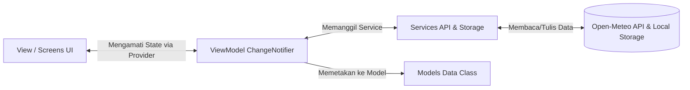

# Aplikasi Cuaca Open-Meteo (Responsi Flutter)

Aplikasi ramalan cuaca modern yang dibangun menggunakan framework **Flutter** dan bahasa pemrograman **Dart**, menerapkan arsitektur **Model-View-ViewModel (MVVM)**, serta mengintegrasikan **REST API Open-Meteo** (Weather Forecast & Geocoding API) dan **Local Storage** (`shared_preferences`) untuk manajemen lokasi favorit.

---

## 📱 Daftar Halaman (Screens)

Aplikasi terdiri dari minimal 2 screen utama sesuai spesifikasi responsi:

### 1. Home / Weather Screen (`HomeScreen`)
* **Nama Kota & Lokasi Terpilih**: Menampilkan nama kota yang sedang aktif beserta wilayah administratif dan negara (misal: *Jakarta, DKI Jakarta, Indonesia*).
* **Kondisi Cuaca Terkini**: Ikon dan deskripsi cuaca dinamis berdasarkan standar WMO (*Cerah, Berawan, Hujan Ringan, Badai Petir, dsb.*).
* **Suhu Saat Ini**: Menampilkan suhu aktual (`current.temperature_2m`) dan suhu yang dirasakan (`current.apparent_temperature`).
* **Informasi Cuaca Tambahan**:
  * Kelembapan udara (`current.relative_humidity_2m` %)
  * Kecepatan angin (`current.wind_speed_10m` km/h)
  * Peluang hujan hari ini (`daily.precipitation_probability_max` %)
  * Curah hujan akumulasi (`current.precipitation` mm)
* **Perkiraan Cuaca 7 Hari**: List ramalan cuaca harian yang memuat tanggal (*Hari ini, Besok, dsb.*), ikon cuaca, peluang hujan, serta rentang suhu minimum dan maksimum harian (`daily.temperature_2m_min` & `daily.temperature_2m_max`).
* **Tombol Interaktif**:
  * Tombol favorit langsung pada AppBar untuk menambah/menghapus kota dari favorit.
  * Tombol navigasi ke layar pencarian kota.
  * Fitur **Pull-to-Refresh** & tombol Refresh manual.

### 2. Search & Favorites Screen (`SearchScreen`)
* **Pencarian Kota Real-time**: Input pencarian kota menggunakan Open-Meteo Geocoding API dengan mekanisme *debounce* (400ms) untuk mengoptimalkan kuota dan performa jaringan.
* **Hasil Pencarian**: Menampilkan daftar kota yang cocok lengkap dengan informasi provinsi, negara, dan koordinat lintang/bujur.
* **Pilih Lokasi**: Mengetuk kota pada daftar hasil pencarian akan langsung memperbarui cuaca di layar utama.
* **Lokasi Favorit Tersimpan**: Menyimpan daftar kota favorit yang tetap tersimpan saat aplikasi ditutup dan dibuka kembali. Terdapat opsi geser/hapus (*dismissible*).
* **Riwayat Pencarian**: Menampilkan kata kunci pencarian terakhir yang dapat ditekan untuk mencari ulang secara instan.

---

## 🏛️ Arsitektur Aplikasi (MVVM)

Aplikasi ini menerapkan pola desain **Model-View-ViewModel (MVVM)** yang memisahkan tanggung jawab kode secara modular:



### 1. Model (`lib/models/`)
Merepresentasikan struktur data murni dan serialisasi JSON:
* `location_model.dart`: Menyimpan data identitas kota, koordinat (`latitude`, `longitude`), negara, dan serialisasi untuk penyimpanan lokal.
* `weather_model.dart`: Memetakan data cuaca terkini dari Open-Meteo API.
* `daily_forecast_model.dart`: Memetakan data perkiraan cuaca 7 hari ke depan.

### 2. Service (`lib/services/`)
Menangani komunikasi eksternal dan persistensi:
* `api_service.dart`: Menangani HTTP GET request ke Open-Meteo Weather API dan Geocoding API dengan penanganan kesalahan (*SocketException, Timeout, FormatException, Http Error Status*).
* `storage_service.dart`: Mengelola penyimpanan lokal menggunakan `shared_preferences` untuk menyimpan kota terakhir yang dibuka, daftar kota favorit, dan riwayat pencarian.

### 3. ViewModel (`lib/viewmodels/`)
Mengelola logika bisnis dan state aplikasi menggunakan `ChangeNotifier`:
* `weather_viewmodel.dart`: Mengatur state cuaca aktif, status loading, error message, dan toggle favorit lokasi saat ini.
* `search_viewmodel.dart`: Mengatur input pencarian, pemanggilan Geocoding API dengan debounce, daftar hasil pencarian, dan pengelolaan daftar favorit.

### 4. View (`lib/views/`)
Komponen antarmuka pengguna (UI) yang bersifat reaktif terhadap perubahan state pada ViewModel:
* `home_screen.dart`: Menampilkan data cuaca terkini, detail metrik, dan perkiraan harian.
* `search_screen.dart`: Menampilkan input pencarian, hasil pencarian, lokasi favorit, dan riwayat.
* Komponen pembantu (`widgets/`): `LoadingView`, `ErrorView` (dengan tombol coba lagi), dan `EmptyView`.

---

## 🌐 Implementasi REST API Open-Meteo

API yang digunakan adalah API publik dari Open-Meteo tanpa memerlukan API key:

### 1. Weather Forecast API
* **Endpoint**: `https://api.open-meteo.com/v1/forecast`
* **Metode**: `GET`
* **Parameter**:
  * `latitude`: Koordinat lintang kota
  * `longitude`: Koordinat bujur kota
  * `current`: `temperature_2m,relative_humidity_2m,apparent_temperature,precipitation,weather_code,wind_speed_10m`
  * `daily`: `weather_code,temperature_2m_max,temperature_2m_min,precipitation_probability_max`
  * `timezone`: `auto`

### 2. Geocoding API
* **Endpoint**: `https://geocoding-api.open-meteo.com/v1/search`
* **Metode**: `GET`
* **Parameter**:
  * `name`: Kata kunci nama kota yang dicari
  * `count`: `10`
  * `language`: `id`
  * `format`: `json`

---

## 📂 Struktur Direktori Proyek

```
lib/
├── main.dart                          # Titik masuk utama aplikasi (MultiProvider & Theme setup)
├── models/
│   ├── daily_forecast_model.dart      # Model data perkiraan harian
│   ├── location_model.dart            # Model lokasi kota & serialisasi JSON
│   └── weather_model.dart             # Model data cuaca terkini & forecast
├── services/
│   ├── api_service.dart               # HTTP client & REST API Open-Meteo
│   └── storage_service.dart           # Local storage (SharedPreferences)
├── utils/
│   ├── app_theme.dart                 # Konfigurasi Material Design 3 Theme
│   ├── date_formatter.dart            # Helper format tanggal & waktu Bahasa Indonesia
│   └── weather_code_helper.dart       # Mapping kode cuaca WMO ke teks, ikon, & gradasi
├── viewmodels/
│   ├── search_viewmodel.dart          # State management pencarian & favorit
│   └── weather_viewmodel.dart         # State management cuaca terkini
├── views/
│   ├── home/
│   │   ├── home_screen.dart           # Screen 1: Layar utama informasi cuaca
│   │   └── widgets/
│   │       ├── current_weather_card.dart  # Kartu hero cuaca terkini
│   │       ├── daily_forecast_list.dart   # List ramalan cuaca 7 hari
│   │       └── weather_details_grid.dart  # Grid kartu metrik cuaca tambahan
│   └── search/
│       ├── search_screen.dart         # Screen 2: Layar pencarian & favorit
│       └── widgets/
│           ├── search_bar_widget.dart     # Input pencarian teks
│           └── search_result_item.dart    # Kartu item hasil pencarian
└── widgets/
    ├── empty_view.dart                # Tampilan state kosong
    ├── error_view.dart                # Tampilan state error dengan tombol Coba Lagi
    └── loading_indicator.dart         # Tampilan state loading
```

---

## 📸 Tangkapan Layar Aplikasi (Screenshots)

| Layar Cuaca Utama (Home) | Layar Pencarian & Favorit | State Error & Penanganan Jaringan |
| :---: | :---: | :---: |
| *(Tangkapan layar Home Screen)* | *(Tangkapan layar Search Screen)* | *(Tangkapan layar Error Screen)* |
| `screenshots/home_screen.png` | `screenshots/search_screen.png` | `screenshots/error_screen.png` |

> *Catatan: Letakkan tangkapan layar aplikasi ke dalam folder `screenshots/` sesuai tabel di atas sebelum pengumpulan.*

---

## ⚙️ Cara Menjalankan Proyek

### 1. Prasyarat
* Flutter SDK (v3.13.0 ke atas)
* Dart SDK (v3.0.0 ke atas)
* Emulator Android/iOS atau Browser Chrome

### 2. Langkah Menjalankan
1. Clone repositori ke komputer lokal Anda:
   ```bash
   git clone <URL_REPOSITORY_ANDA>
   cd Responsi-Flutter
   ```
2. Pasang semua dependensi aplikasi:
   ```bash
   flutter pub get
   ```
3. Verifikasi kode tidak memiliki error:
   ```bash
   flutter analyze
   flutter test
   ```
4. Jalankan aplikasi pada perangkat/emulator:
   ```bash
   flutter run
   ```

---

## 📝 Informasi Pengumpulan Responsi
* **Mata Kuliah**: Praktikum Pemrograman Bergerak / Flutter
* **Batas Waktu**: 26 November 2026, Pukul 10:00 WIB
* **Form Pengumpulan**: [Google Forms Responsi Flutter](https://forms.gle/vz5LUdPVZmJ2F5uKA)
* **Tautan Video Penjelasan**: *(Cantumkan link YouTube / Google Drive video penjelasan kode)*
